# Kiến trúc media video và revision 2D

Giữ ASP.NET Core10 MVC/Razor, EF Core10/SQL Server, Identity/permission, workflow và scheduler cũ. Không static-serve original/temp/output, không URL upload ngoài, broker, Redis, HLS hoặc timer encode trong web. Tất cả thao tác nghiệp vụ chỉ SQL Test/kho Test ở mốc local.

```mermaid
flowchart LR
  B[File máy biên tập viên] --> S[SQL UploadSession + receipts]
  S --> C[Streaming chunk private]
  C --> H[Assemble và xác minh SHA]
  H --> Q[Original immutable / quarantine]
  Q --> W[Worker SQL lease và quyền hiện thời]
  W --> A[Scanner thật đúng byte]
  A --> P[Probe / encode hoặc remux / poster]
  P --> V[Verify byte / codec / duration / protected receipt]
  V --> R[Ready]
  R --> D[Asset association trong revision]
  D --> F[Approval / scheduler đúng revision]
  F --> U[PublishedRevision + ACL + GET/HEAD/Range]
```

`VideoUploadSession`, `VideoChunk`, `VideoFile` thêm ở migration `20261015041226_VideoUploadPipeline`; `VideoSubtitle` ở `20261015044936_VideoSubtitles`. Bảng gốc không đổi. VideoFile chính là job bền vững cho một original; không cần thêm broker/job table. SQL rowversion, applock, lease token, attempts/backoff và hash fence ngăn hai complete/worker hoặc kết quả đến muộn ghi đè. Cấu hình mặc định concurrency1, threads2,3attempts, session24h; chunk≤8MiB, file≤1GiB, sốchunk≤8192. Buffer server64KiB, WebCrypto chỉ buffer từng chunk.

Session gắn owner và ContentId trước khi nhận byte. Tất cả endpoint kiểm quyền hiện thời, CSRF cho mutation, ACL theo content, trạng thái nháp/rowversion. Replay chunk cùng hash idempotent; đổi byte/index/order hoặc đổi manifest bị chặn. Crash sau rename chunk trước commit được reconcile bằng actual size/hash. Complete tính whole SHA, đóng băng original và một job, không dùng trạng thái client cấp.

Original luôn private và `IsQuarantined=true`, kể cả đã Clean/Ready: generic `/media` không phục vụ video/VTT. Worker giữ read handle khóa ghi, hash trước/sau scanner và processor; ghi proof provider/engine/signature/time/SHA, safe error, attempt, latency và probe đầu vào/đầu ra trong audit. ScanClean không đồng nghĩa codec hợp lệ. Chỉ full pipeline đủ MP4 H264/AAC (hoặc không audio), poster thật và file/hash đúng mới Ready. Không dùng cờ `AllowUnscannedMedia` cho video/phụ đề.

Output từng attempt có thư mục GUID, không overwrite revision khác. Receipt `result.dat` được DataProtection bảo vệ, gắn policy/asset/inputSHA/binarySHA/outputSHA. Policy2 kiểm cả pixel format/profile H264yuv420p/AAC-LC, không reuse receipt policy1 theo điều kiện cũ. Retry sau crash trước SQL commit chỉ reuse receipt hợp lệ sau hash/probe lại; vẫn scan lại original trước reuse. Receipt không phải quyền public. Output thất bại/mồ côi còn tính quota vật lý; cleanup bounded chỉ dọn chunk và output attempt không active/không tham chiếu sau TTL. Không hard-delete original, source hoặc shared revision. Original mồ côi cần đối soát thủ công có audit/backup; không tự dọn theo phỏng đoán.

Quota là reservation bảo thủ cộng byte vật lý original/output/VTT (kể cả mồ côi), chunk SQL và dung lượng dự phòng. Có thể từ chối sớm hơn dung lượng dùng thực; không hứa packing tối đa. Inventory vượt10000entry đóng nhận thêm và yêu cầu đối soát. Disk guard đọc free bytes thật, không tạo file giả làm đầy đĩa. Deadline/working-set monitor512MiB, allocation limit64MiB, protocol file/pipe, ArgumentList/no-shell, threads/pixels/FPS/duration/output cap giảm rủi ro native. Đây chưa là sandbox OS cứng; Production cần tài khoản/process isolation và capacity/load validation được duyệt.

Liên kết `ContentAsset/DraftAsset Usage=Video|Subtitle` thuộc revision. Caption cũng thuộc revision, không đặt metadata biên tập trên VideoFile để thay bản public. HTML sanitizer chặn rawvideo/iframe; component render player từ association PublishedRevision. Subtitle plaintext≤1MiB có original riêng/quét riêng/lease riêng, gắn parentVideo và chỉ công khai nếu cả video+subtitle ở **cùng** published revision. Tham chiếu video công khai ở bài khác không mở quyền phụ đề riêng.

`/video-media/{id}/play|poster`, `/video-track/{id}` kiểm PublishedRevision, Ready/Clean, proof và file byte thực; private preview cần content scope/current permission. GET/HEAD MP4 dùng FileStream/ASP.NET Range, ETagSHA/IfRange/LastModified/200/206/416. No-store/private để việc gỡ còn có hiệu lực ở request sau; không tuyên bố thu hồi byte đã nhận. Việc hash file trên request tạo disk I/O đáng kể: đã kiểm correctness với fixture nhẹ, chưa nghiệm thu tải1GiB/IIS/concurrency production.

DefenderTest chỉ Development+SQLTest+isolated storage+allowlist SHA fixture vô danh/public. Không thay AV/cloud policy; không gửi private file lên SaaS; không apply53Testcopies sang53sourceDev. Production/Staging và Dev upload mặc định khóa. Binary FFmpeg/ffprobe do người vận hành cung cấp, pin SHA, license reference, không nằm repository/package.
